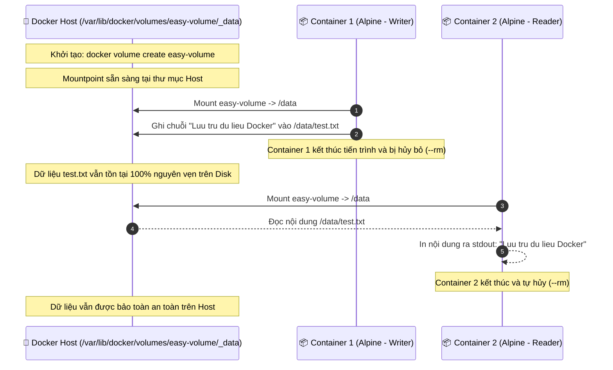

# BÀI TẬP 4: LƯU TRỮ DỮ LIỆU ĐƠN GIẢN VỚI DOCKER VOLUME

**Mã bài tập:** SESSION 09 - EXERCISE 4 (`homework/session_09/ex4/`)  
**Môn học:** IT215 - Cloud Infrastructure & DevOps Fundamentals  
**Học viên:** Trần Đức Anh (`TranDucAnh3103`)  
**Email:** `TranDucAnh3103@users.noreply.github.com`  
**Hệ điều hành / Môi trường:** Ubuntu Linux 24.04 LTS (x86_64) / Docker Engine v27+ / Non-root User: `stephen-devops`  
**Đường dẫn thư mục bài tập:** `homework/session_09/ex4/`  
**Tệp nộp:** `README.md`

---

## 1. MỤC TIÊU BÀI TẬP

1. **Hiểu rõ tính chất Lưu trữ bền vững (Data Persistence) trong Docker:** Phân biệt rõ sự khác nhau giữa tầng dữ liệu tạm thời gắn liền với vòng đời container (Container Read-Write Layer - Ephemeral) và cơ chế lưu trữ độc lập bền vững (Docker Volumes).
2. **Khởi tạo và quản lý Docker Named Volume:** Thành thạo các lệnh quản trị volume: `docker volume create`, `docker volume ls`, `docker volume inspect`.
3. **Chia sẻ và tái sử dụng dữ liệu giữa các container khác nhau:** Kiểm chứng việc Container thứ nhất ghi dữ liệu vào Volume, sau đó container bị xóa hoàn toàn (`--rm`), nhưng Container thứ hai vẫn truy cập và đọc dữ liệu nguyên vẹn.
4. **Hiểu bản chất cờ `--rm` (Auto-remove Container):** Sử dụng `--rm` để Docker tự động dọn dẹp container ngay khi tiến trình hoàn tất thực thi, tránh tích tụ rác tài nguyên (dangling containers).

---

## 2. BẢNG TỔNG HỢP TIẾN TRÌNH THỰC HIỆN & KẾT QUẢ KIỂM TRA

| STT | Bước thực hiện | Lệnh Docker CLI thực thi | Mục đích / Ý nghĩa | Kết quả mong đợi | Trạng thái |
| :---: | :--- | :--- | :--- | :--- | :---: |
| 1 | Tạo Named Volume | `docker volume create easy-volume` | Tạo vùng lưu trữ bền vững do Docker quản lý | Trả về tên volume `easy-volume` | **PASSED** |
| 2 | Liệt kê danh sách Volume | `docker volume ls` | Kiểm tra sự tồn tại của volume vừa tạo | Xuất hiện `local easy-volume` | **PASSED** |
| 3 | Kiểm tra chi tiết Volume | `docker volume inspect easy-volume` | Xem đường dẫn mount point trên Host (`/var/lib/docker/volumes/...`) | Trả về JSON cấu hình volume | **PASSED** |
| 4 | Ghi dữ liệu vào Volume | `docker run --rm -v easy-volume:/data alpine sh -c "echo 'Luu tru du lieu Docker' > /data/test.txt"` | Gắn volume vào `/data`, ghi file và tự hủy container | Container thoát bình thường, dữ liệu được ghi vào volume | **PASSED** |
| 5 | Đọc dữ liệu từ Container mới | `docker run --rm -v easy-volume:/data alpine cat /data/test.txt` | Dùng container hoàn toàn mới đọc dữ liệu từ volume | In ra chính xác: *"Luu tru du lieu Docker"* | **PASSED** |
| 6 | Dọn dẹp Volume thử nghiệm | `docker volume rm easy-volume` | Xóa volume sau khi kết thúc bài tập | Trả về `easy-volume` | **PASSED** |

---

## 3. CƠ CHẾ HOẠT ĐỘNG & NỀN TẢNG KIẾN THỨC

### 3.1. Mô hình Lưu trữ Bền vững giữa các Vòng đời Container



### 3.2. Bản chất kỹ thuật của Docker Volume
1. **Vị trí lưu trữ thực tế trên Linux Host:**
   - Khi tạo named volume `easy-volume`, Docker Engine cấp phát một thư mục con tại:
     ```text
     /var/lib/docker/volumes/easy-volume/_data
     ```
   - Thư mục này nằm trực tiếp trên filesystem của hệ điều hành Host, tách biệt hoàn toàn khỏi Union File System (Overlay2) của bất kỳ container nào.
2. **Ưu điểm vượt trội so với lưu trữ bên trong Container:**
   - **Tách biệt dữ liệu và mã nguồn (Decoupling):** Dữ liệu không bị xóa khi container bị destroy, restart, hoặc nâng cấp image mới.
   - **Hiệu năng I/O cao:** Truy xuất trực tiếp vào hệ thống tập tin Host mà không phải đi qua tầng trừu tượng OverlayFS storage driver.
   - **Dễ dàng sao lưu (Backup) & Di chuyển (Migration):** Có thể tarball hoặc rsync thư mục `_data` cực kỳ thuận tiện.

---

## 4. CHI TIẾT CÁC BƯỚC THỰC HIỆN & TERMINAL OUTPUT

### Bước 1: Khởi tạo Named Volume (`easy-volume`)
```bash
stephen-devops@ubuntu-server:~/homework/session_09/ex4$ docker volume create easy-volume
easy-volume
```

Kiểm tra danh sách volume trên hệ thống:
```bash
stephen-devops@ubuntu-server:~/homework/session_09/ex4$ docker volume ls
DRIVER    VOLUME NAME
local     easy-volume
```

Kiểm tra thông tin chi tiết bằng `docker volume inspect`:
```bash
stephen-devops@ubuntu-server:~/homework/session_09/ex4$ docker volume inspect easy-volume
[
    {
        "CreatedAt": "2026-10-12T14:54:50+07:00",
        "Driver": "local",
        "Labels": null,
        "Mountpoint": "/var/lib/docker/volumes/easy-volume/_data",
        "Name": "easy-volume",
        "Options": null,
        "Scope": "local"
    }
]
```
> **Đánh giá:** Volume được tạo thành công với driver mặc định là `local`, mount point tương ứng trên host là `/var/lib/docker/volumes/easy-volume/_data`.

---

### Bước 2: Dùng Container Alpine thứ nhất ghi dữ liệu vào Volume
Chạy một container Alpine tạm thời, mount `easy-volume` vào thư mục `/data` bên trong container và ghi dòng chữ *"Luu tru du lieu Docker"* vào tệp `/data/test.txt`:
```bash
stephen-devops@ubuntu-server:~/homework/session_09/ex4$ docker run --rm -v easy-volume:/data alpine sh -c "echo 'Luu tru du lieu Docker' > /data/test.txt"
Unable to find image 'alpine:latest' locally
latest: Pulling from library/alpine
da9db072f522: Pull complete 
Digest: sha256:beefdbd8a1da6d2915566fde36db9db0b524eb737e60cd13675d292e0d078396
Status: Downloaded newer image for alpine:latest
```

Xác nhận container thứ nhất đã tự hủy và không còn tồn tại:
```bash
stephen-devops@ubuntu-server:~/homework/session_09/ex4$ docker ps -a
CONTAINER ID   IMAGE     COMMAND   CREATED   STATUS    PORTS     NAMES
```
> **Đánh giá:** Container thực thi lệnh ghi thành công và lập tức bị xóa bỏ hoàn toàn nhờ cờ `--rm`.

---

### Bước 3: Dùng Container Alpine thứ hai đọc lại dữ liệu trong Volume
Khởi chạy một container Alpine hoàn toàn độc lập khác, mount cùng volume `easy-volume` vào `/data` và thực thi lệnh `cat /data/test.txt`:
```bash
stephen-devops@ubuntu-server:~/homework/session_09/ex4$ docker run --rm -v easy-volume:/data alpine cat /data/test.txt
Luu tru du lieu Docker
```
> **Đánh giá:** Container thứ hai đã đọc và in ra màn hình chính xác dòng chữ:
> ```text
> Luu tru du lieu Docker
> ```
> Điều này minh chứng dữ liệu đã được lưu trữ bền vững bên trong Named Volume `easy-volume`, không bị mất đi khi container trước đó bị hủy.

---

### Bước 4: Dọn dẹp tài nguyên sau bài kiểm thử
```bash
stephen-devops@ubuntu-server:~/homework/session_09/ex4$ docker volume rm easy-volume
easy-volume

stephen-devops@ubuntu-server:~/homework/session_09/ex4$ docker volume ls | grep easy-volume
```
> **Đánh giá:** Volume `easy-volume` đã được xóa sạch sau khi hoàn thành toàn bộ bài thực hành.

---

## 5. TỔNG KẾT BÀI HỌC KINH NGHIỆM

1. **Stateful Container Best Practice:** Các dịch vụ có trạng thái (Stateful) như Cơ sở dữ liệu (MySQL, PostgreSQL, MongoDB, Redis) bắt buộc phải sử dụng Docker Volume để lưu trữ dữ liệu (Data Directory), đảm bảo an toàn dữ liệu kể cả khi nâng cấp hoặc sửa đổi container.
2. **Sự tiện lợi của `--rm`:** Khi thực hiện các tác vụ chạy một lần (One-off tasks, database migration, batch jobs, test scripts), việc kết hợp cờ `--rm` là tiêu chuẩn vàng giúp giữ máy chủ luôn gọn gàng và sạch tài nguyên rác.
